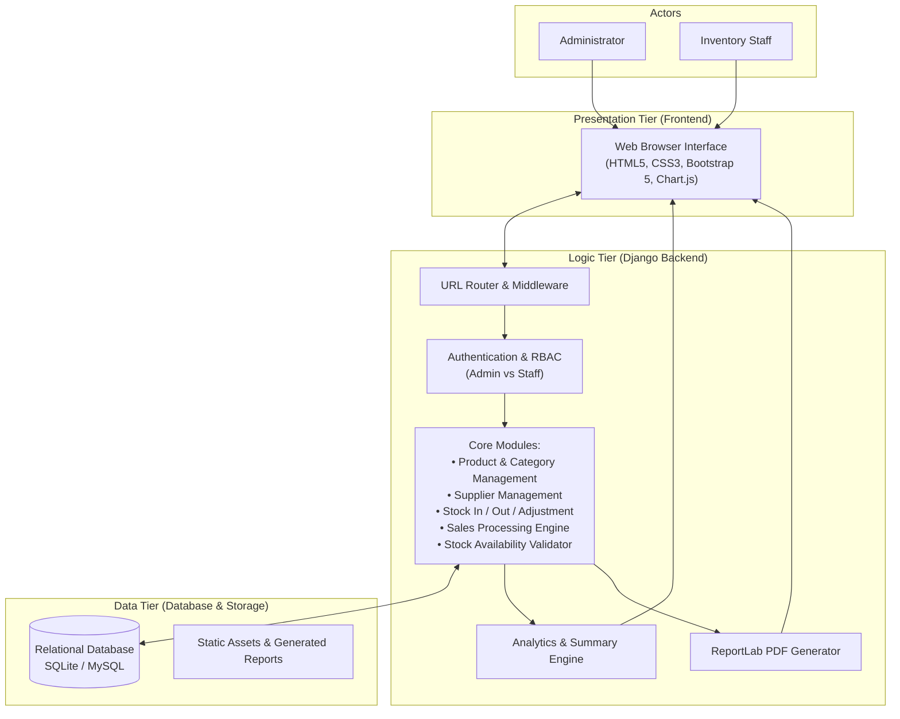
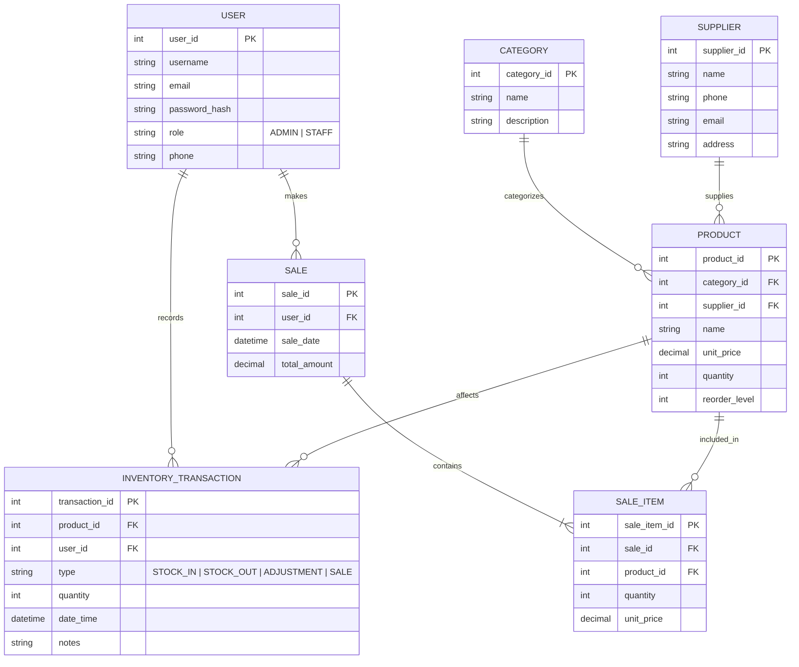
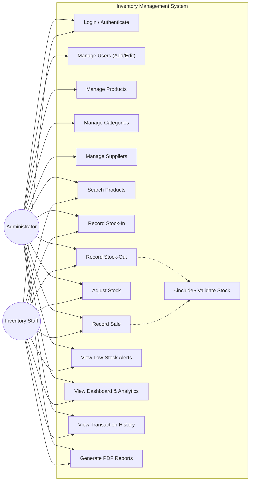
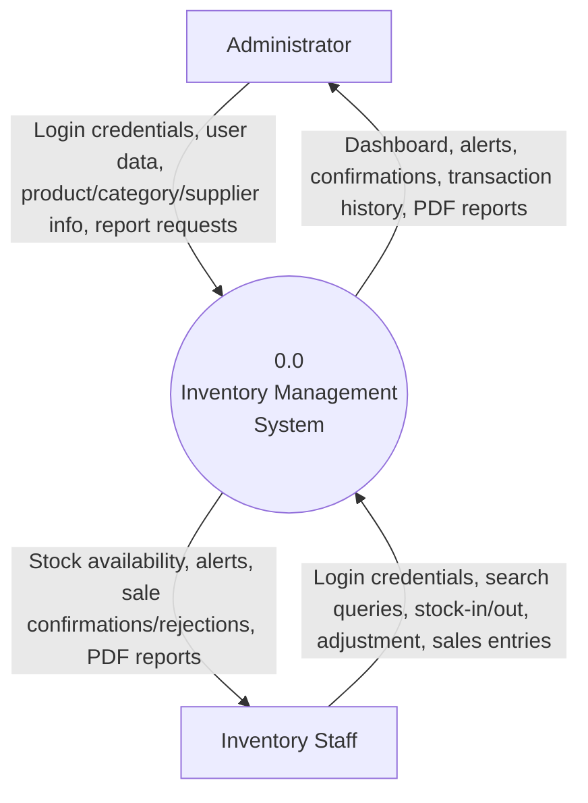
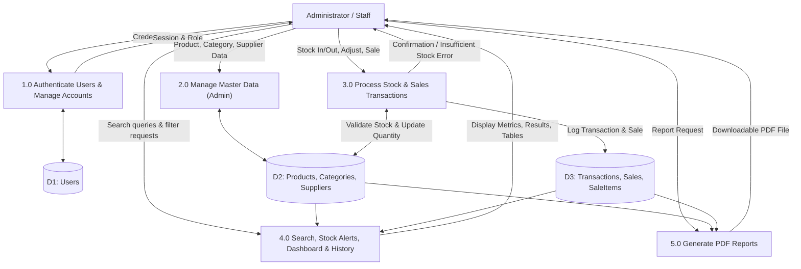
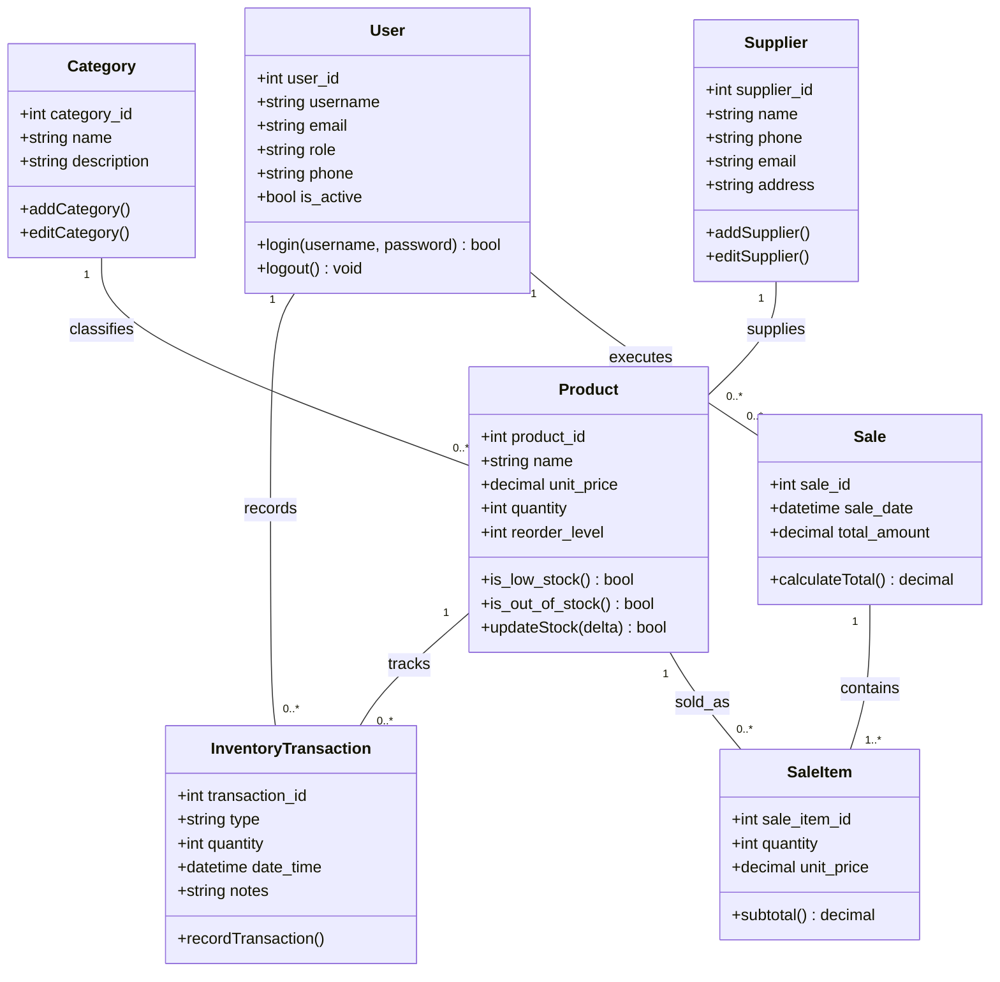
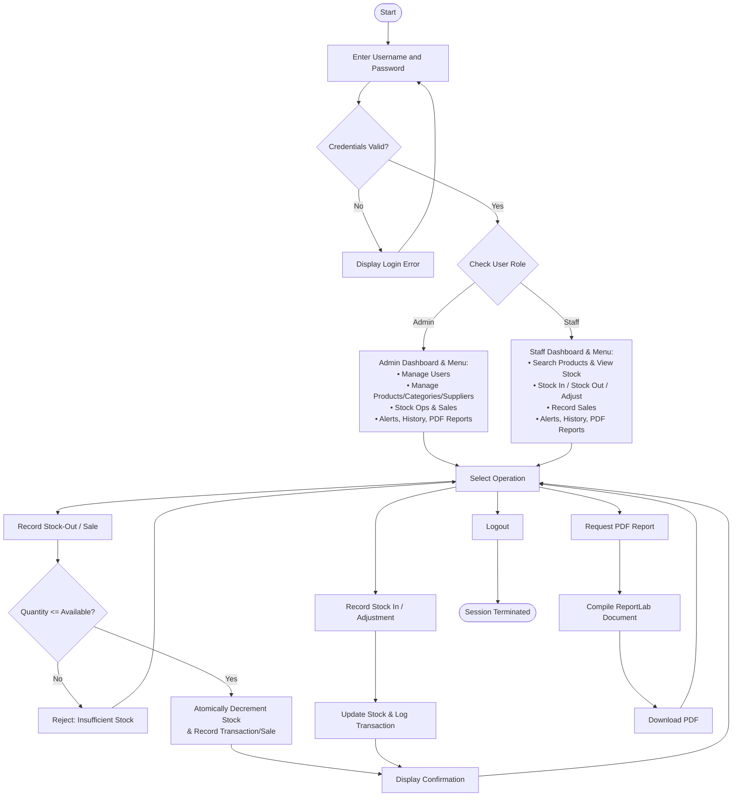
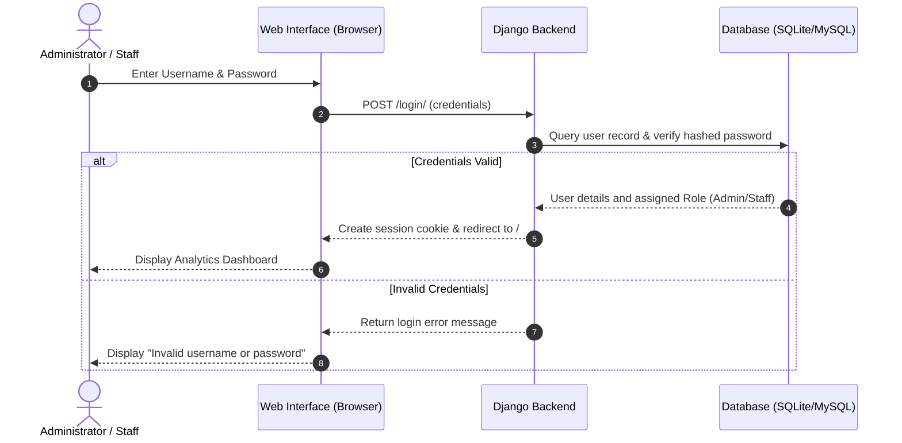
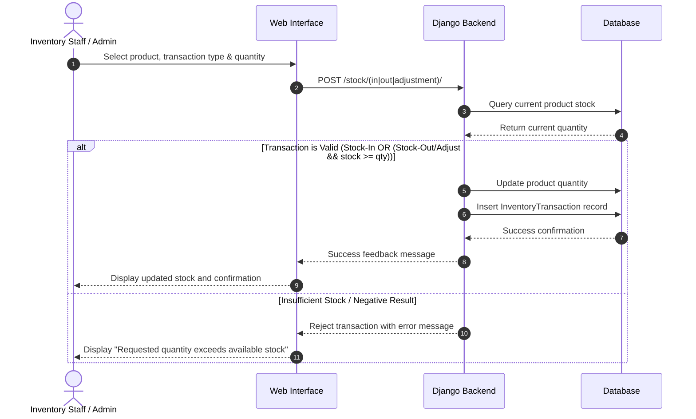
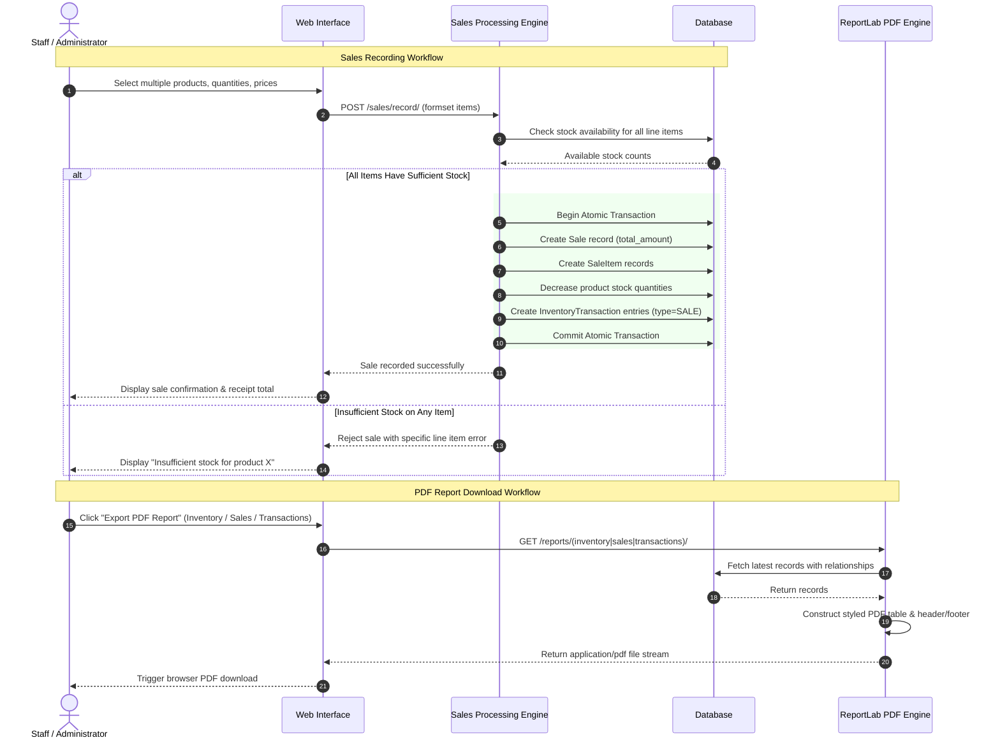

# SOFTWARE REQUIREMENTS SPECIFICATION (SRS)
## Inventory Management System (IMS)

---

## TABLE OF CONTENTS
1. [Introduction](#1-introduction)
   - 1.1 [Purpose](#11-purpose)
   - 1.2 [Scope](#12-scope)
   - 1.3 [Definitions and Abbreviations](#13-definitions-and-abbreviations)
2. [Information Gathering Methods](#2-information-gathering-methods)
   - 2.1 [Method Comparison](#21-method-comparison)
3. [Requirement Specifications](#3-requirement-specifications)
   - 3.1 [Functional Requirements](#31-functional-requirements)
   - 3.2 [Non-Functional Requirements](#32-non-functional-requirements)
   - 3.3 [Data Requirements](#33-data-requirements)
   - 3.4 [System Requirements](#34-system-requirements)
4. [Design and Analysis](#4-design-and-analysis)
   - 4.1 [System Architecture](#41-system-architecture)
   - 4.2 [Database Design / Entity-Relationship Diagram](#42-database-design--entity-relationship-diagram)
   - 4.3 [Detailed Design Diagrams](#43-detailed-design-diagrams)
     - 4.3.1 [Use Case Diagram](#431-use-case-diagram)
     - 4.3.2 [Level 0 DFD (Context Diagram)](#432-level-0-dfd-context-diagram)
     - 4.3.3 [Level 1 DFD](#433-level-1-dfd)
     - 4.3.4 [Class Diagram](#434-class-diagram)
     - 4.3.5 [Activity Diagram](#435-activity-diagram)
     - 4.3.6 [Sequence Diagram – Login and Authentication](#436-sequence-diagram--login-and-authentication)
     - 4.3.7 [Sequence Diagram – Stock Transaction](#437-sequence-diagram--stock-transaction)
     - 4.3.8 [Sequence Diagram – Sales Recording and PDF Report](#438-sequence-diagram--sales-recording-and-pdf-report)
   - 4.4 [Design Tools and Limitations](#44-design-tools-and-limitations)
5. [Implementation](#5-implementation)
   - 5.1 [Technology Stack Justification](#51-technology-stack-justification)
   - 5.2 [Interface Design](#52-interface-design)
   - 5.3 [Verification and Traceability](#53-verification-and-traceability)

---

## 1. Introduction

### 1.1 Purpose
This Software Requirements Specification (SRS) defines the functional, non-functional, data, interface and design requirements of the **Inventory Management System (IMS)**. The system is a centralized web-based platform for managing products, categories, suppliers, inventory transactions, sales, transaction history, low-stock alerts, an analytics dashboard and PDF reports.

### 1.2 Scope
The IMS provides administrators and authorized staff with:
- User authentication and role-based access control (Admin / Staff)
- Product, category, and supplier management
- Stock-in, stock-out, and stock adjustment operations
- Sales recording with multi-item transactions
- Stock availability validation ensuring non-negative inventory
- Low-stock and out-of-stock identification and alerts
- Comprehensive transaction history audit trail
- Analytics dashboard with graphical summaries (Chart.js)
- Downloadable PDF reports (ReportLab)

**Out of Scope:**
Full POS billing and invoicing, online payment gateways, financial accounting, payroll, customer relationship management (CRM), multi-warehouse and shipment/logistics tracking, advanced demand forecasting, and automatic procurement are outside the scope of this project.

### 1.3 Definitions and Abbreviations

#### Table 1: Definitions and Abbreviations
| Term | Meaning |
| :--- | :--- |
| **SRS** | Software Requirements Specification |
| **IMS** | Inventory Management System |
| **FR / NFR** | Functional Requirement / Non-Functional Requirement |
| **Administrator** | User with full management, configuration, and user administrative permissions |
| **Staff** | Authorized user who performs routine inventory and sales operations |
| **Stock-In** | Transaction that increases available product quantity |
| **Stock-Out** | Transaction that decreases available product quantity |
| **Stock Adjustment** | Authorized correction of product quantity (e.g., damaged goods, returns, count discrepancy) |
| **Low Stock** | Product quantity at or below its configured reorder level |
| **Out of Stock** | Product whose available quantity is zero |

---

## 2. Information Gathering Methods

### 2.1 Method Comparison

#### Method 1: Synopsis and Document Analysis
- **Strengths:** Directly captures approved objectives, scope, users, features, and technology stack of the project, keeping requirements consistent with the initial project synopsis.
- **Weaknesses:** The synopsis is a high-level document and does not describe detailed workflows or data rules.
- **Application:** Analyzed to identify the actors (Administrator and Staff), functional areas (authentication, master data, stock and sales transactions, validation, alerts, dashboard, history, reports), and out-of-scope boundaries.

#### Method 2: Literature and Technical Documentation Review
- **Strengths:** Software engineering literature and official framework documentation provide proven practices for requirements engineering, relational schema design, and secure web application development.
- **Weaknesses:** General literature does not address the specific business nuances of this inventory system without adaptation.
- **Application:** Sommerville and Pressman guided the SRS structure and requirement criteria, while Django, MySQL/SQLite, Chart.js, and ReportLab official documentation guided architectural and technology choices.

#### Most Effective Approach
A combination of both methods was used: the synopsis defined **what** the system must accomplish, and literature/documentation supported **how** requirements and architecture are designed and executed.

---

## 3. Requirement Specifications

### 3.1 Functional Requirements

#### FR-001: User Authentication and Role-Based Access Control
- **Description:** The system shall authenticate registered users before granting access to protected functions. It shall reject invalid credentials with a descriptive error message, associate each authenticated user with a specific role (`Administrator` or `Staff`), restrict administrative functions strictly to Administrators, and provide secure logout.
- **Priority:** High
- **Dependencies:** Database user table, Django authentication subsystem.

#### FR-002: User Account Management
- **Description:** An Administrator shall be able to add, update, and manage user accounts and assign each user an `Administrator` or `Staff` role.
- **Priority:** High
- **Dependencies:** FR-001.

#### FR-003: Product, Category and Supplier Management
- **Description:** An Administrator shall be able to add and update products, manage product categories, and add and update supplier information. The system shall maintain each product's relationship with its category and supplier.
- **Priority:** High
- **Dependencies:** FR-001.

#### FR-004: Product Search and Stock Status
- **Description:** Authorized users shall be able to search for products (by name, category, or supplier) and view current stock information. The system shall identify a product as **low stock** when its quantity is at or below its reorder level, and as **out of stock** when its quantity reaches zero.
- **Priority:** High
- **Dependencies:** FR-001, FR-003.

#### FR-005: Inventory and Sales Transactions
- **Description:** Authorized users shall be able to record stock-in, stock-out, stock adjustment, and sales transactions. Each transaction shall be associated with the recording user, the relevant product, timestamps, and optional notes.
- **Priority:** High
- **Dependencies:** FR-001, FR-003.

#### FR-006: Stock Validation and Automatic Update
- **Description:** Before processing a stock-out or sale, the system shall read the current stock and reject the transaction if the requested quantity exceeds available stock. For an accepted transaction, the system shall automatically increase stock for stock-in or decrease stock for stock-out/sale, shall never allow quantity to become negative, and shall record every transaction into the immutable transaction history.
- **Priority:** High
- **Dependencies:** FR-001, FR-005.

#### FR-007: Dashboard and Transaction History
- **Description:** The system shall display inventory and sales summaries on an interactive analytics dashboard (with visual Chart.js charts) and maintain a searchable/filterable transaction history. Authorized users can review logs according to their role.
- **Priority:** Medium
- **Dependencies:** FR-001, FR-006.

#### FR-008: PDF Report Generation
- **Description:** Authorized users shall be able to generate and download formatted inventory, sales, and transaction reports in PDF format using ReportLab.
- **Priority:** Medium
- **Dependencies:** FR-001, FR-006, FR-007.

---

### 3.2 Non-Functional Requirements

- **Performance:** Common operations such as product search, stock updates, sales recording, and dashboard rendering shall respond quickly under normal project-scale usage.
- **Security:**
  - *Authentication:* Only authenticated users access protected functions; authorization strictly enforced by role.
  - *Password Protection:* Passwords are never stored in plain text; Django's cryptographic PBKDF2/SHA256 password-hashing mechanism is utilized.
  - *Input Validation:* All user input is sanitized and validated via Django Forms and ORM before database execution, protecting against SQL injection, XSS, and CSRF attacks.
- **Usability:**
  - *Interface:* Simple, responsive, and intuitive interface with clear labels, helpful validation feedback, and Bootstrap styling.
  - *Visibility:* Low-stock and out-of-stock items are visually highlighted with color-coded badges (Green = OK, Yellow/Warning = Low Stock, Red/Danger = Out of Stock).
- **Reliability and Maintainability:**
  - *Data Consistency:* Inventory is updated atomically inside transactions only after validation succeeds; transaction history records are never lost.
  - *Modularity:* Decoupled architectural layers (Models, Views, Forms, Reports, Templates) ensure that updates in one module do not disrupt others.

---

### 3.3 Data Requirements

#### Data Entities and Attributes

1. **User**
   - `user_id` (PK, AutoField)
   - `username` (CharField, Unique)
   - `name` / `first_name`, `last_name` (CharField)
   - `email` (EmailField, login identifier / contact)
   - `password_hash` (CharField)
   - `role` (CharField: `ADMIN`, `STAFF`)
   - `phone` (CharField, Optional)

2. **Category**
   - `category_id` (PK, AutoField)
   - `name` (CharField, Unique)
   - `description` (TextField, Optional)

3. **Supplier**
   - `supplier_id` (PK, AutoField)
   - `name` (CharField)
   - `phone` (CharField)
   - `email` (EmailField)
   - `address` (TextField)

4. **Product**
   - `product_id` (PK, AutoField)
   - `name` (CharField)
   - `category_id` (FK -> Category)
   - `supplier_id` (FK -> Supplier)
   - `unit_price` (DecimalField)
   - `quantity` (PositiveIntegerField, Default: 0)
   - `reorder_level` (PositiveIntegerField, Default: 10)
   - `created_at` (DateTimeField)
   - `updated_at` (DateTimeField)

5. **InventoryTransaction**
   - `transaction_id` (PK, AutoField)
   - `product_id` (FK -> Product)
   - `user_id` (FK -> User)
   - `type` (CharField: `STOCK_IN`, `STOCK_OUT`, `ADJUSTMENT`, `SALE`)
   - `quantity` (IntegerField)
   - `date_time` (DateTimeField, auto_now_add)
   - `notes` (TextField, Optional)

6. **Sale**
   - `sale_id` (PK, AutoField)
   - `user_id` (FK -> User)
   - `sale_date` (DateTimeField, auto_now_add)
   - `total_amount` (DecimalField)

7. **SaleItem**
   - `sale_item_id` (PK, AutoField)
   - `sale_id` (FK -> Sale)
   - `product_id` (FK -> Product)
   - `quantity` (PositiveIntegerField)
   - `unit_price` (DecimalField)

#### Data Relationships
- A `Category` classifies many `Products` (1:N).
- A `Supplier` supplies many `Products` (1:N).
- A `Product` has many `InventoryTransactions`, and a `User` records many `InventoryTransactions` (1:N).
- A `User` makes many `Sales`, and a `Sale` contains one or more `SaleItems` (1:N).
- A `Product` appears in many `SaleItems` (1:N). Each `SaleItem` creates a corresponding `InventoryTransaction` of type `SALE` so that stock movements remain synchronized in history.

#### Table 2: Data Validation Rules
| Data | Validation Rule |
| :--- | :--- |
| **Product quantity** | Non-negative integer; must never be negative after any accepted transaction. |
| **Transaction quantity** | Positive integer for `stock-in`, `stock-out`, and `sale`. For `adjustment`, may be positive or negative provided resulting stock >= 0. |
| **Reorder level** | Non-negative integer. |
| **Email** | Valid format and unique per user. |
| **Role** | Must be strictly `Administrator` (`ADMIN`) or `Staff` (`STAFF`). |
| **Sale quantity** | Shall not exceed available product stock. |
| **Required fields** | Validated via form cleaning before database write. |

---

### 3.4 System Requirements

- **Software Requirements:**
  - Operating System: Windows 10/11, Linux, or macOS.
  - Browser: Chrome, Firefox, Edge, Safari.
  - Backend: Python 3.10+ with Django 4.2+ / 5.x / 6.x.
  - Database: SQLite (default development) / MySQL (production supported).
  - Key Libraries: Bootstrap 5, Font Awesome 6, Chart.js, ReportLab.
- **Hardware Requirements:**
  - Processor: Intel Core i3 or equivalent (or higher).
  - RAM: 8 GB or higher.
  - Storage: 10 GB free disk space.
  - Network: Standard network connectivity for browser access.

---

## 4. Design and Analysis

### 4.1 System Architecture

---

### 4.2 Database Design / Entity-Relationship Diagram

---

### 4.3 Detailed Design Diagrams

#### 4.3.1 Use Case Diagram

---

#### 4.3.2 Level 0 DFD (Context Diagram)

---

#### 4.3.3 Level 1 DFD

---

#### 4.3.4 Class Diagram

---

#### 4.3.5 Activity Diagram

---

#### 4.3.6 Sequence Diagram – Login and Authentication

---

#### 4.3.7 Sequence Diagram – Stock Transaction

---

#### 4.3.8 Sequence Diagram – Sales Recording and PDF Report

---

### 4.4 Design Tools and Limitations

- **Design Tools:** Unified Modeling Language (UML) structural and behavioral diagrams, Data Flow Diagrams (Level 0 and 1), and Entity-Relationship diagrams to specify architectural boundaries, workflows, and persistence models.
- **Limitations:** The platform is purpose-built for core inventory tracking, stock movements, and sales logging. Complex point-of-sale hardware integration, financial payroll, CRM lead management, and automated supply forecasting are excluded.

---

## 5. Implementation

### 5.1 Technology Stack Justification

| Layer | Technology | Justification |
| :--- | :--- | :--- |
| **Frontend** | HTML5, CSS3, JavaScript, Bootstrap 5 | Delivers a clean, responsive interface without the overhead and build complexity of heavyweight frontend frameworks. |
| **Analytics** | Chart.js 4.x | Lightweight, canvas-based rendering for responsive bar, line, and doughnut charts on the dashboard. |
| **Backend** | Python 3.x with Django | Built-in secure authentication, password hashing, role-based access decorators, ORM with atomic transactions, and CSRF protection. |
| **Database** | SQLite (Dev) / MySQL (Prod) | Full ACID compliance, foreign-key referential integrity, and portable deployment. |
| **PDF Generation** | ReportLab | Industry standard Python PDF generation engine for pixel-accurate, downloadable reports with pagination and headers. |

---

### 5.2 Interface Design
- **Web Interface:** Fully responsive web application accessible across desktop and mobile devices.
- **Login Screen:** Centered, secure authentication card with error notifications.
- **Analytics Dashboard:** KPI metric cards, Category Stock chart, Monthly Transaction trend, and Low-Stock table.
- **Interactive Forms:** Intuitive forms with client-side calculation (dynamic sales invoice line items) and server-side validation.
- **Reports:** Direct one-click PDF generation buttons with real-time download.

---

### 5.3 Verification and Traceability Matrix

#### Table 3: Verification and Traceability Matrix
| Test ID | Requirement | Design Reference | Acceptance Criterion |
| :--- | :--- | :--- | :--- |
| **TC01** | FR-001 | Use case: Authenticate User; Sequence diagrams | Valid credentials permit access; invalid credentials are rejected with an informative error. |
| **TC02** | FR-001 | Role-based access; Decorators | Administrator functions (User management, Categories, Suppliers, Product creation/editing) are restricted from Staff users. |
| **TC03** | FR-002, FR-003 | Use cases: Manage Users, Products, Categories, Suppliers | Administrators can create and update users, categories, suppliers, and products; updates reflect immediately. |
| **TC04** | FR-004 | Use case: Search Products | Authorized users can search and view product details and available stock. |
| **TC05** | FR-004 | Use case: View Stock Status & Low-Stock Alerts | Products at or below reorder level show **Low Stock** (yellow); zero quantity displays **Out of Stock** (red). |
| **TC06** | FR-005, FR-006 | Use cases: Record Stock-In, Adjust Stock | Valid stock-in or positive/negative adjustment updates quantity accurately and records an audit log in history. |
| **TC07** | FR-005, FR-006 | Use cases: Record Stock-Out | Valid stock-out decreases quantity and logs a transaction with the acting user's identity. |
| **TC08** | FR-006 | Use case: Validate Stock Availability | A stock-out or sale exceeding available quantity is strictly rejected; stock is unchanged. |
| **TC09** | FR-005, FR-006 | Use case: Record Sale; Sale, SaleItem | A valid sale atomically creates Sale, SaleItem entries, decrements stock, and logs SALE transactions. |
| **TC10** | FR-007 | Use cases: View Dashboard, View Transaction History | Analytics dashboard displays dynamic totals and charts; history view displays filterable transaction logs. |
| **TC11** | FR-008 | Use case: Generate PDF Report | Authorized users can download readable, formatted PDF reports for inventory, sales, and transactions. |
| **TC12** | NFR Section 3.2 | Security, usability, performance and reliability | CSRF protection, password hashing, transaction atomicity, responsive styling, and sub-second responses. |

---
*End of Software Requirements Specification (SRS)*
